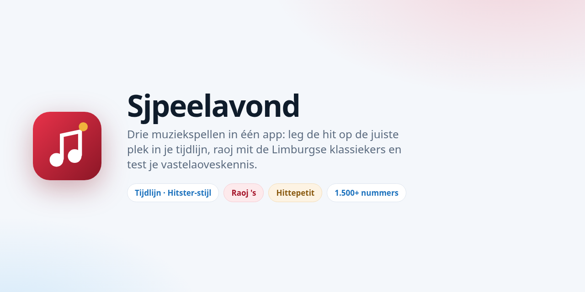

# Sjpeelavond

**Drie muziekspellen in één webapp.** Je hoort een fragment van 30 seconden en legt de kaart op de
juiste plek in je tijdlijn: *Tijdlijn* (in de stijl van Hitster), *Raoj 's* met zijn vier Limburgse
varianten en *Hittepetit* met Zittesj vastelaovesrepertoire. Eén telefoon of laptop op tafel is
genoeg — geen Spotify-abonnement, geen losse kaartjes, geen app die je eerst moet installeren.


## Wat het doet

| Spel | Wat je doet |
|---|---|
| **Tijdlijn** | Klassiek tijdlijnspel: wie legt het eerst tien kaarten goed op chronologische volgorde? Met fiches om over te slaan, te stelen en kaarten te kopen. |
| **Raoj 's** | Vier varianten op Limburgs repertoire: *Raoj 's* (tijdlijn), *Zîng 's* (meezingen), *Stop 's* (herkennen na de eerste klanken, met buzzers) en *LVJao of LVNein* (was dit een LVK-inzending?). |
| **Hittepetit** | Tijdlijnspel op Zittesj en Limburgs vastelaovesrepertoire, met **nónnevotte** in plaats van fiches. |

Alle muziek komt uit de eigen dataset: **1.751 nummers**, waarvan **926 Limburgse
nummers** (503 vastelaovesnummers en 513 liedjes waarvan bekend is of ze een
LVK-inzending waren). De hitlijsten lopen van **1965 tot nu**.

## Schermafbeeldingen

| Startpagina | Spelers en dekken |
|---|---|
| 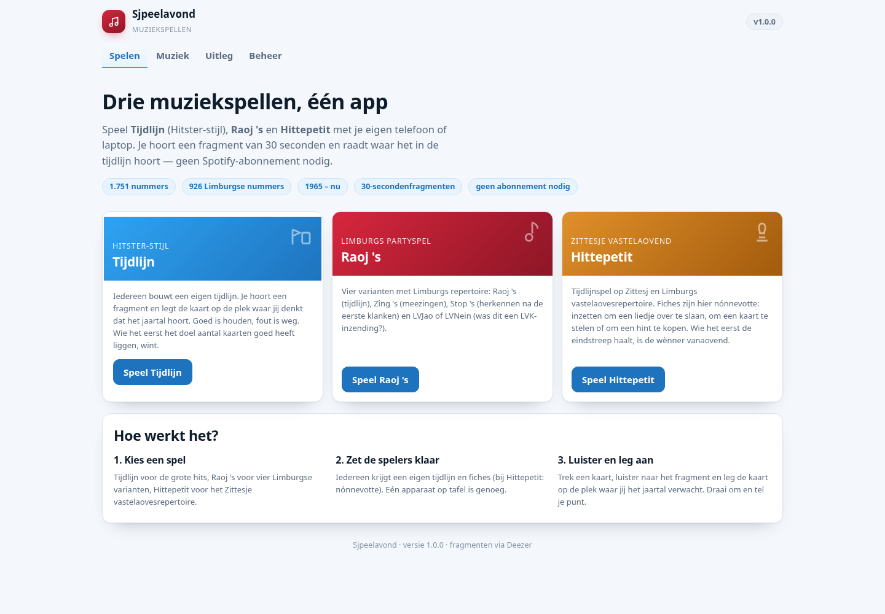 | 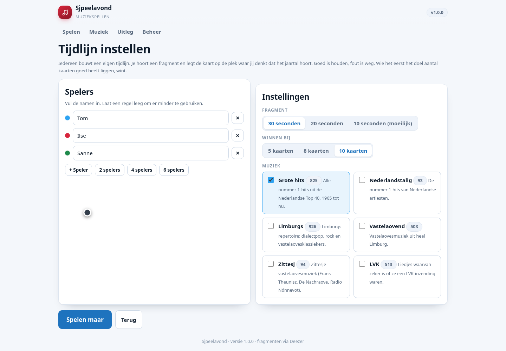 |

| Kaart trekken en luisteren | Plek kiezen in de tijdlijn |
|---|---|
| 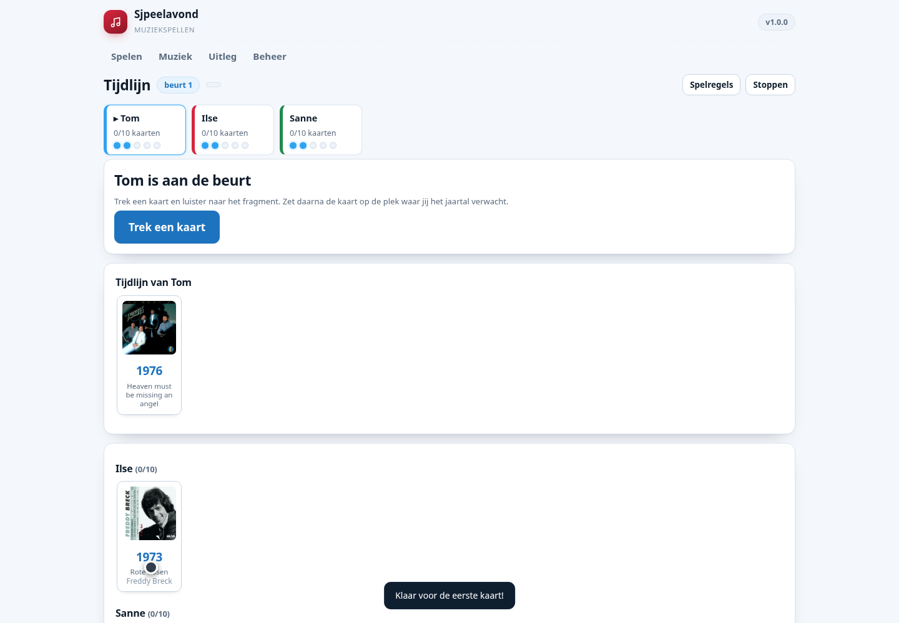 | 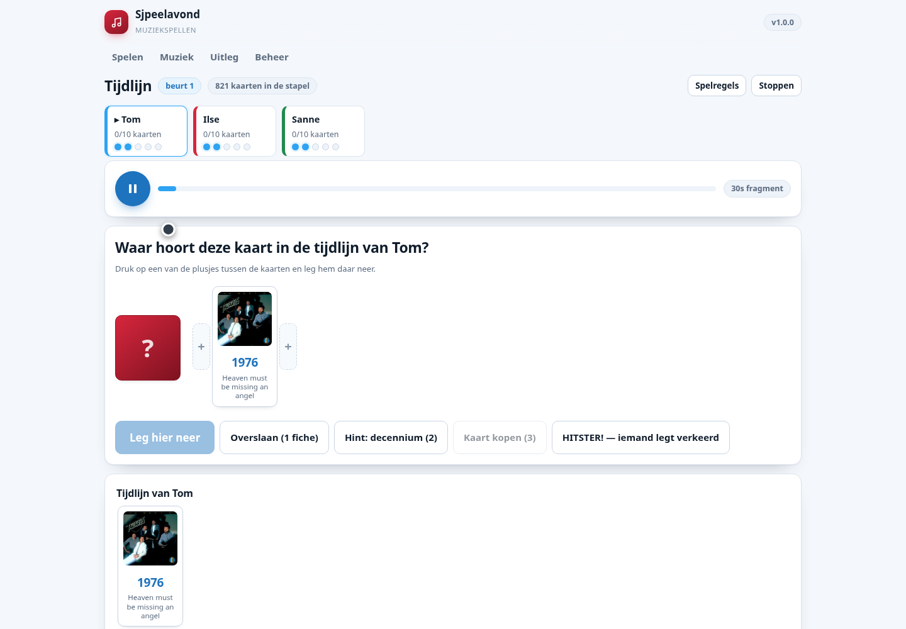 |

| Jaartal onthuld | Tijdlijnen van iedereen |
|---|---|
| 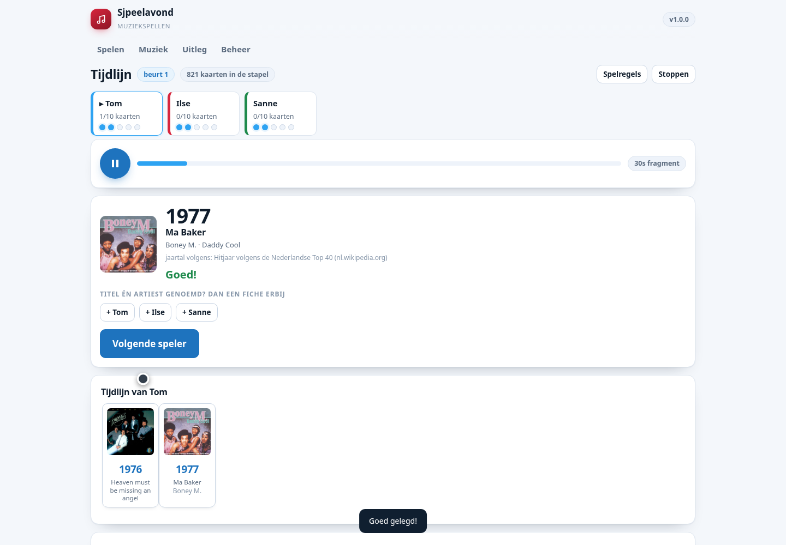 | 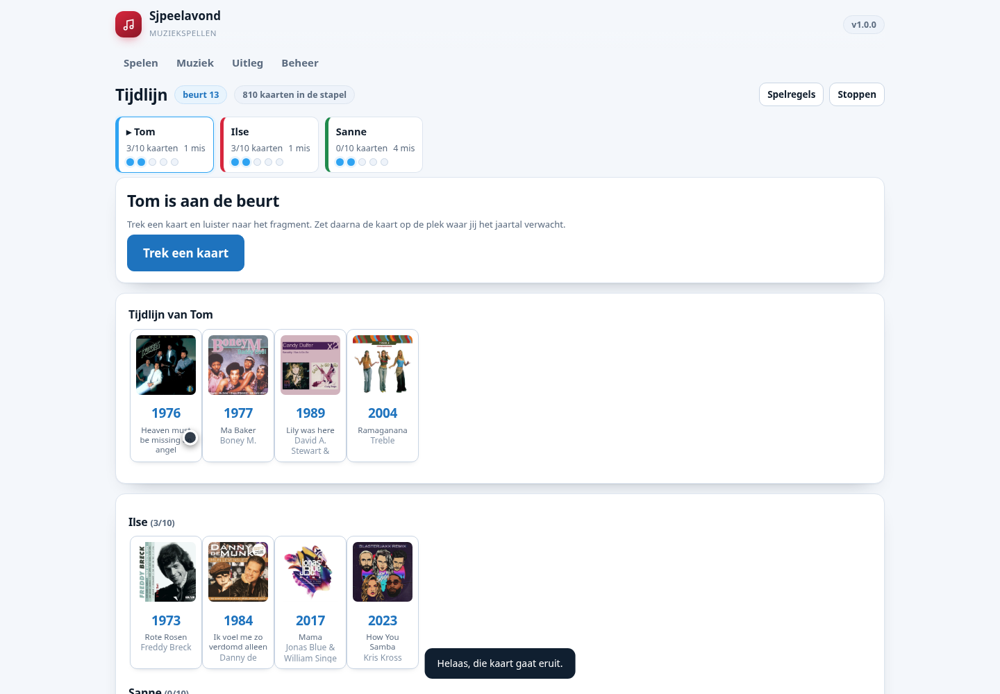 |

| Stop 's met buzzers | Hittepetit met nónnevotte |
|---|---|
| 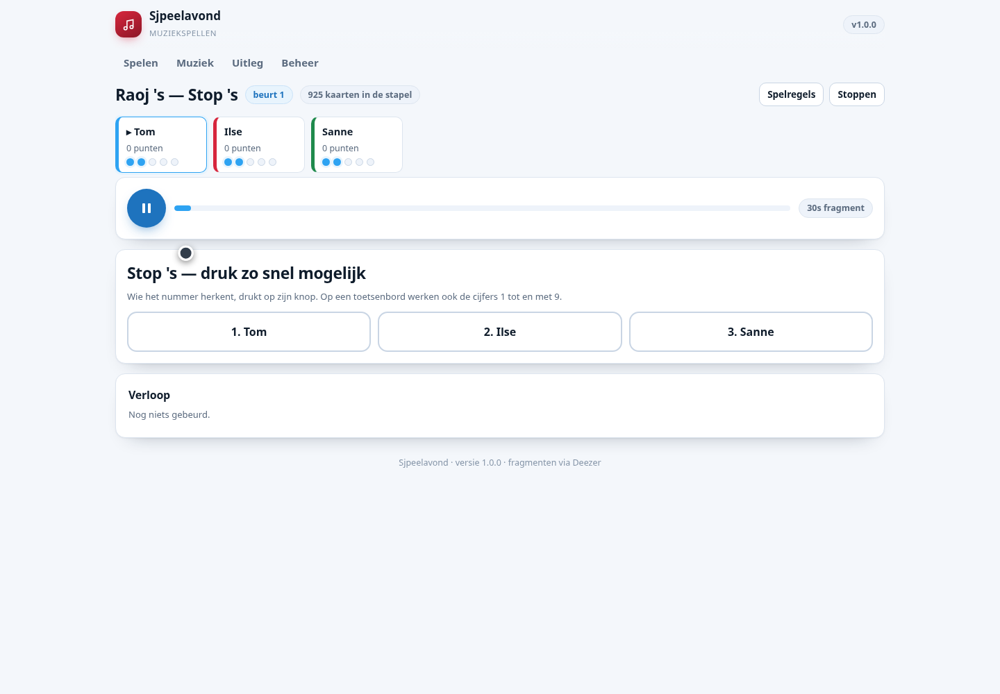 | 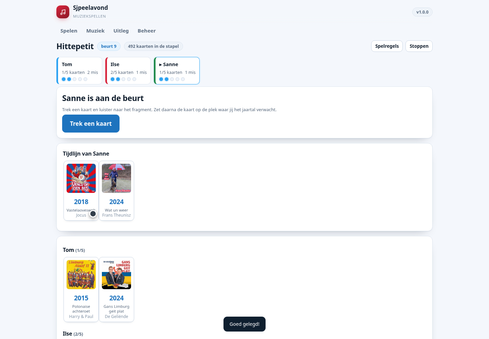 |

| Muziekbibliotheek | Op de telefoon |
|---|---|
| 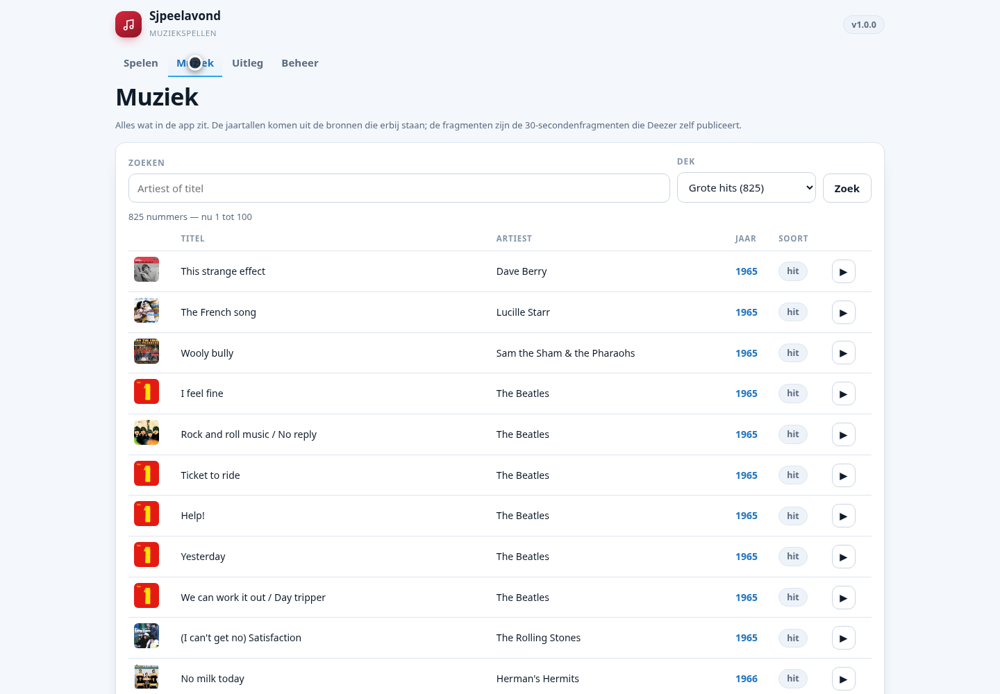 | 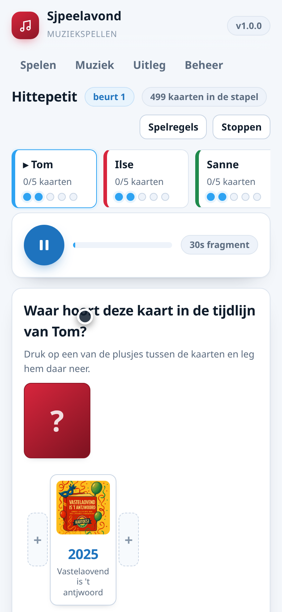 |

Een doorloop van de app staat in [docs/demo.mp4](docs/demo.mp4).

## Installeren op Proxmox

Draai dit op de Proxmox-host (root):

```bash
bash -c "$(curl -fsSL https://raw.githubusercontent.com/Theberas04/sjpeelavond/main/deploy/proxmox/install.sh)"
```

De installer maakt een Debian-LXC, zet Node 22 en de app erin, genereert een beheerderswachtwoord
en print aan het eind het adres. Alles staat in [`deploy/proxmox/README.md`](deploy/proxmox/README.md).

Lokaal draaien kan ook:

```bash
node server.js          # http://localhost:8080
```

## Spelen

De volledige gebruikershandleiding staat in [`docs/handleiding.md`](docs/handleiding.md). In het kort:

1. Kies een spel en vul de spelersnamen in.
2. Kies je dek (grote hits, Nederlandstalig, Limburgs, vastelaovend, Zittesj) en hoe lang het fragment is.
3. Druk op **Trek een kaart**, luister, en leg de kaart op de plek waar jij het jaartal verwacht.
4. Draai om: goed is houden, fout is van tafel.

Op een laptop werken de cijfertoetsen 1–9 als buzzers bij *Stop 's*, en de spatiebalk trekt een kaart
of start het fragment.

## Waar de muziek vandaan komt

Deze app speelt de **30-secondenfragmenten die Deezer zelf publiek aanbiedt** bij zijn nummers; er
wordt geen muziek gedownload of opgeslagen. De hoesjes komen van dezelfde bron. Vraagt Deezer geen
fragment op, dan probeert de server het via de iTunes Search API.

| Onderdeel | Bron | Opmerking |
|---|---|---|
| Hitlijsten | [nummer 1-hits in de Nederlandse Top 40](https://nl.wikipedia.org/wiki/Lijsten_van_nummer_1-hits_in_de_Nederlandse_Top_40) (nl.wikipedia.org) | alleen de feitelijke gegevens (artiest, titel, hitjaar) overgenomen; Wikipedia is CC BY-SA 4.0 |
| Limburgs repertoire | Deezer (topnummers van Limburgse artiesten en vastelaoveszoektermen) | titel, artiest, album, jaartal, hoes en fragment |
| Jaartallen Limburgs | LVK-liedjeslijst (L1 / Stichting LVK), [MusicBrainz](https://musicbrainz.org) (first-release-date) en Deezer (vroegste albumjaar) | welk jaartal gebruikt is, staat per nummer in de dataset en in de app bij het onthullen |
| LVK-inzendingen | winnaars van nl.wikipedia.org + halvefinalisten- en finalistenlijsten van L1 | 628 liedjes uit 50 jaargangen |

**Over de spellen zelf.** Sjpeelavond is een eigen, niet-commerciële implementatie geïnspireerd op
bestaande muziekspellen: *Hitster* (Jumbo), *Raoj 's* van Raoj's en *Hittepetit* van Radio Nónnevot
en De Marotte Zitterd. De kaarten, de muziekkeuze en de vormgeving van die spellen zitten hier niet
in. De spelregels zijn de algemeen bekende regels, aangevuld met eigen varianten waar de officiële
regels niet openbaar zijn.

**Eén eerlijke beperking:** het Zittesje vastelaovesrepertoire bestaat voor een groot deel uit
opnamen die niet op streamingdiensten staan (Radio Nónnevot schrijft dat zelf ook). De Hittepetit van
De Marotte heeft 222 kaarten waarvan wij de lijst niet hebben; dit spel gebruikt daarom het
vastelaovesrepertoire dat wél beschikbaar is. Via **Beheer → Eigen nummers** kun je zelf muziek
toevoegen die je in huis hebt, en die gewoon meespelen.

## Zelf de dataset opbouwen

Alles is opnieuw te genereren; de tussenstappen worden bewaard in `data/bron/`:

```bash
node scripts/haal-top40.mjs        # nummer 1-hits van nl.wikipedia.org
node scripts/verrijk-hits.mjs      # daar per nummer het Deezer-nummer, hoes en fragment bij zoeken
node scripts/haal-limburg.mjs      # Limburgs/vastelaovesrepertoire via Deezer
node scripts/haal-lvk.mjs          # LVK-inzendingen per jaargang
node scripts/verrijk-jaar.mjs      # jaartallen (LVK-lijst, MusicBrainz, Deezer)
node scripts/bouw-dataset.mjs      # alles samenvoegen tot data/nummers-*.json
node scripts/maak-iconen.mjs       # app-iconen en de social card
```

Elk script print een rapport (hoeveel gevonden, hoeveel overgeslagen en waarom). De dataset in de
repo is het resultaat van die reeks.

## Testen

```bash
node --test test/app.test.js
```

De suite dekt de spellogica (plaatsen, gelijke jaartallen, fiches, stelen, buzzers, winnen), alle
API-routes (inclusief de grendel op beheer) en de gebouwde dataset zelf: elk nummer heeft een
jaartal, een titel, een artiest, een fragment en een dek, en de id's blijven in hun eigen bereik.

## Beheer

Alles wat je speelt en bekijkt is voor iedereen. Wat **toevoegt of verandert** zit achter één
beheerderswachtwoord (dat de installer voor je maakt): eigen nummers toevoegen met een mp3, m4a, wav
of ogg, en ze weer verwijderen. Dat is de route voor muziek die je zelf hebt — bijvoorbeeld
Zittesje opnamen die nergens te streamen zijn.

## Opbouw van de repo

```
server.js                    HTTP, API en de dataset in het geheugen (geen npm)
public/index.html            de hele pagina: opmaak en schermen
public/js/spel.js            alle spellogica, los van de pagina en dus testbaar
public/js/app.js             de bediening: schermen, knoppen, geluid
data/nummers-hits.json       de hits (id 1 en verder)
data/nummers-limburg.json    het Limburgse repertoire (id 100000 en verder)
data/bron/                   de ruwe oogst waaruit de dataset gebouwd wordt
scripts/                     de oogst-, verrijkings- en opnamescripts
test/app.test.js             de testsuite
deploy/proxmox/              de installatiekit met one-liner
docs/                        handleiding, schermafbeeldingen en de demo-opname
```

---

© Werdens Media. Alle rechten voorbehouden.
